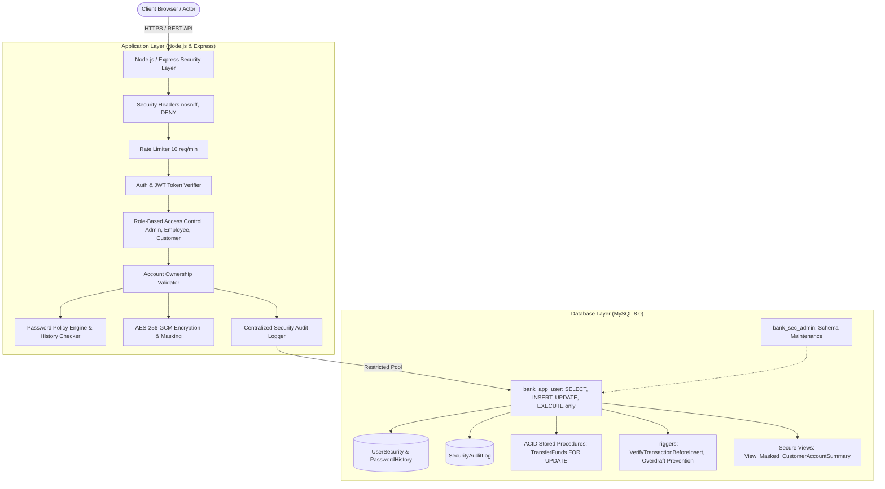

# Database Security and Privacy (DSP) Upgrade: Project Overview & Architecture

## 1. Project Overview & Academic Objectives

The **GlobalTrust Banking Management System** was originally designed as a relational database application demonstrating 3NF database normalization, stored procedures, triggers, views, and ACID transactions. 

For the **Database Security and Privacy (DSP)** syllabus, the application has been upgraded into an enterprise-grade secure banking platform. The core objective is to integrate robust defensive security mechanisms—spanning authentication credentials, password policy governance, role-based access control (RBAC), least privilege database accounts, application-layer encryption, dynamic data masking, tamper-resistant audit logging, and vendor-specific database profile controls—while **100% preserving all existing customer data, accounts, balances, and financial history**.

---

## 2. Original vs. Upgraded Architecture Comparison

### Original Architecture (Basic DBMS)
* **Authentication:** Non-existent security. Single endpoint `POST /api/login` queried `SELECT * FROM Customer WHERE Email = ?`. No password hashing, no credential verification, no session tokens.
* **Authorization:** Client-side only. `localStorage.getItem('customer')` dictated access. Direct API queries allowed Insecure Direct Object References (IDOR), enabling any client to view or transfer money from any account.
* **Database Connection:** Backend used MySQL `root` superuser with full global privileges.
* **Data Privacy:** Account numbers, phone numbers, and balances exposed in raw plaintext across all responses.
* **Auditing:** Minimal trigger writing to `TransactionLog` with no user context, IP tracking, or security event classification.

### Upgraded DSP Architecture (Defense-in-Depth)
* **Multi-Tiered Security Governance:**
  1. **Presentation / Web Layer:** Dynamic data masking (e.g. `•••• •••• 1001`), responsive forms with two-step transfer review modals, secure session tokens, and security headers.
  2. **Application / Middleware Layer:** Password Policy Engine (12+ character complexity, 5-history reuse prevention, 90-day aging, 5-attempt lockout for 15 minutes, common password blacklist), JWT token versioning (instant session invalidation upon password reset or deactivation), strict server-side RBAC, and AES-256-GCM symmetric encryption for sensitive identification.
  3. **Database Layer (MySQL 8.0):** Separation of application service accounts (`bank_app_user`) from DBA accounts (`bank_sec_admin`) under the Principle of Least Privilege, ACID transactions with row-level locking (`SELECT ... FOR UPDATE`), `BEFORE INSERT` triggers preventing overdrafts, secure views, and structured `SecurityAuditLog` tables.

---

## 3. Technology Stack & Environment

| Component | Technology | Version | Purpose |
| :--- | :--- | :--- | :--- |
| **Backend Runtime** | Node.js | v24.14.0 | RESTful API server & security middleware |
| **Framework** | Express.js | 4.19.2 | Routing, rate limiting, and HTTP pipeline |
| **Database Engine** | MySQL Community Server | 8.0.45 x64 | Relational storage, ACID procedures, constraints |
| **Password Hashing** | Bcrypt / Argon2id | 10 Salt Rounds | One-way irreversible credential storage |
| **Session Security** | JSON Web Tokens (jsonwebtoken) | HS256 with Versioning | Stateless session tokens with instant revocation |
| **Confidentiality** | Crypto (AES-256-GCM) | 256-bit Key / 96-bit IV | Authenticated application-layer data encryption |
| **Frontend Styling** | Vanilla CSS + Bootstrap 5 | 5.3.0 | Professional financial aesthetic (No AI gimmicks) |
| **Icons & Typography** | Bootstrap Icons + Inter | 1.11.1 / Google Fonts | Modern, restrained visual hierarchy |
