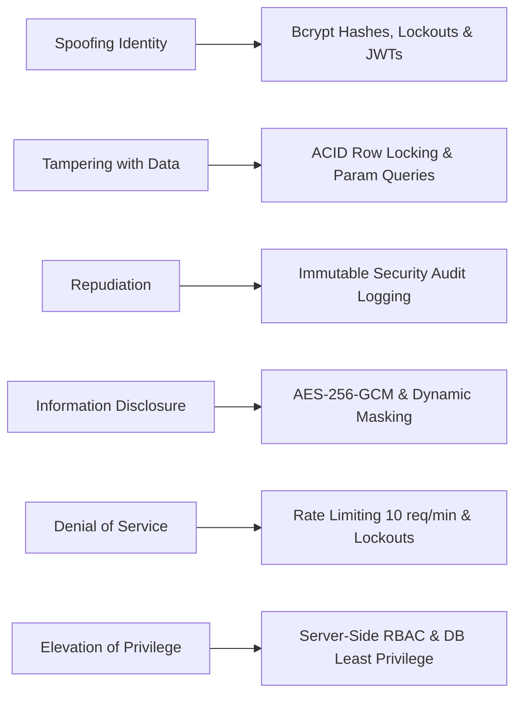

# Security Gap Analysis & STRIDE Threat Model

## 1. Security Gap Analysis of Pre-Existing System

Prior to this upgrade, the Banking Management System suffered from several critical vulnerabilities typical of prototype database projects:

| # | Vulnerability Category | Pre-Existing Flaw | Impact / Risk Severity | DSP Mitigation Implemented |
| :- | :--- | :--- | :--- | :--- |
| **G1** | **Authentication Absence** | Authentication relied solely on entering an email address. No password or secret was queried or validated. | **CRITICAL:** Anyone knowing a client's email could impersonate them and initiate transactions. | Implemented Bcrypt password hashing, Password Policy Engine, salt generation, and secure credential storage in `UserSecurity`. |
| **G2** | **Broken Object Level Auth (IDOR)** | Endpoints like `/api/customers/:id/accounts` accepted arbitrary IDs without checking the caller's identity. | **HIGH:** A customer could view and modify any other customer's accounts and loans. | Implemented `requireAccountOwnership` middleware comparing caller's JWT token ID with target record owners. |
| **G3** | **Excessive DB Privileges** | Application backend connected using `root` superuser with full global privileges. | **CRITICAL:** SQL injection or application compromise would grant total server control (DROP DATABASE, shell access). | Created dedicated `bank_app_user` with restricted DML privileges (`SELECT, INSERT, UPDATE, EXECUTE`) and NO DDL. |
| **G4** | **Unprotected Data at Rest** | Sensitive PII (Phone, Email, Addresses, Balances) stored entirely in plaintext. | **HIGH:** Offline database access or backup theft exposes customer identities and balances. | Implemented AES-256-GCM authenticated encryption for sensitive KYC data, plus server-side dynamic masking. |
| **G5** | **Lack of Security Auditing** | Only transaction insert triggers wrote to `TransactionLog`. No logs for logins, failed logins, or admin actions. | **MEDIUM:** Security incidents, account takeovers, and unauthorized access could not be investigated or audited. | Built structured `SecurityAuditLog` tracking Actor, ActionType, Target, Outcome, IP, and sanitized metadata. |
| **G6** | **Session & Replay Vulnerability** | Sessions existed as unverified JSON strings in `localStorage`. | **HIGH:** Session hijacking, inability to revoke compromised sessions. | Implemented JWT tokens with `TokenVersion` tracking for instant session invalidation upon password change. |

---

## 2. STRIDE Threat Model for Banking Operations

The application was analyzed against the Microsoft **STRIDE** threat categorization model:

### 1. Spoofing Identity
* **Threat:** An attacker guesses a customer's password or replays an expired token.
* **Mitigation:** Strict password complexity policy (minimum 12 characters, uppercase, lowercase, numbers, special characters), dictionary rejection of common passwords, rate-limiting on login endpoints, automatic 15-minute account lockout after 5 consecutive failures, and cryptographically signed JWT tokens with expiration.

### 2. Tampering with Data
* **Threat:** Concurrent fund transfers modify balances simultaneously (race conditions), or an attacker injects malicious SQL payloads to alter accounts.
* **Mitigation:**
  - 100% parameterized queries in `mysql2` preventing SQL injection.
  - Stored procedure `TransferFunds` wraps operations in `START TRANSACTION`, utilizes `SELECT Balance FROM Account WHERE AccountNo = ? FOR UPDATE` row locking, and triggers rollback upon errors.
  - `BEFORE INSERT` triggers and database `CHECK (Balance >= 0)` constraints reject invalid debits.

### 3. Repudiation
* **Threat:** A user or rogue administrator performs a fraudulent transaction or alters a password policy and denies the action.
* **Mitigation:** Centralized tamper-resistant `SecurityAuditLog` captures Actor ID, Role, Action Type, Target Resource, Outcome (SUCCESS/FAILURE/WARNING), IP address, and timestamp. Ordinary users and employees possess zero delete or update privileges on the audit log table.

### 4. Information Disclosure
* **Threat:** Interception of API responses leaks customer account numbers or sensitive national identification numbers.
* **Mitigation:**
  - Dynamic server-side masking renders account numbers as `•••• •••• 1001` across customer and statement views.
  - Sensitive government IDs and tax IDs are encrypted using authenticated symmetric encryption (AES-256-GCM) with an environment-isolated 256-bit key.
  - Centralized error handlers suppress internal SQL errors and database credentials.

### 5. Denial of Service (DoS)
* **Threat:** Automated credential stuffing or brute force scripts overwhelm authentication endpoints or database connection pools.
* **Mitigation:** Sliding-window rate limiter (10 requests per minute per IP) returns `HTTP 429 Too Many Requests` with `Retry-After` headers; account lockout halts brute force guessing against specific user identities.

### 6. Elevation of Privilege
* **Threat:** A customer modifies their role from `Customer` to `Admin` by manipulating request payloads, or a bank employee accesses administrative security configurations.
* **Mitigation:**
  - Server-side RBAC middleware (`requireRole`) checks the signed JWT role claim on every protected endpoint.
  - Role modifications require Admin authentication and automatically invalidate existing tokens by incrementing `TokenVersion`.
  - Database application user (`bank_app_user`) lacks `GRANT`, `SUPER`, `CREATE USER`, or `ALTER` permissions in MySQL.
