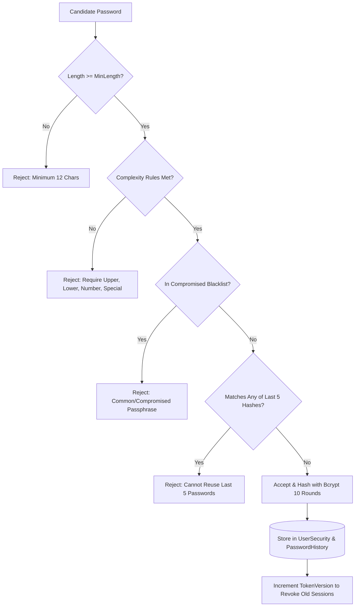
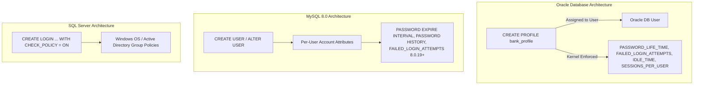

# Password Policy Engine & Database User Administration

## 1. Password Policy Engine Architecture (Phase A)

The Password Policy Engine is a configurable, multi-layered security subsystem implemented in Node.js and backed by MySQL persistent metadata. It enforces enterprise password governance across all banking users.



### Configured Policy Rules & Defaults:
1. **Minimum Password Length:** Enforces minimum 12 characters (`policy.MinLength = 12`).
2. **Password Complexity:** Requires uppercase (`[A-Z]`), lowercase (`[a-z]`), numeric (`[0-9]`), and special characters (`[!@#$%^&*...]`).
3. **Common Passwords Blacklist:** Filters out commonly compromised passwords (e.g., `password123!`, `banking2026!`, `admin123456!`, `letmein12345`).
4. **Password Aging (Expiration):** Configured demonstration policy of 90 days. If `DATEDIFF(NOW(), PasswordLastChanged) > 90`, login sets `mustChangePassword = true` and prompts immediate update.
5. **Password History Restriction:** Pre-existing password hashes are stored in `PasswordHistory`. Reusing any of the last 5 passwords is automatically rejected using `bcrypt.compare`.
6. **Account Lockout Policy:** Consecutive failed attempts increment `FailedLoginAttempts`. Upon reaching 5 failures, `LockoutUntil` is set to `NOW() + 15 MINUTE`. Access is denied with `HTTP 423 Locked` until the timer expires or an administrator intervenes.
7. **Session Invalidation:** Bumps `TokenVersion` on password change, administrative reset, or account disabling. Active sessions with older token versions are instantly rejected.
8. **Irreversible Hash Storage:** Passwords hashed with `bcrypt` (10 salt rounds). Plaintext passwords and reversible encryption are strictly forbidden.

---

## 2. Password Policy Management (Phase B)

Administrators manage policies dynamically via the **Security & Privacy Dashboard**:
* Real-time modification of `MinLength`, character classes, `ExpirationDays`, `HistoryLimit`, `MaxFailedAttempts`, and `LockoutDurationMinutes`.
* Persisted in MySQL table `PasswordPolicyConfig` (PolicyID = 1).
* Modifications are restricted to the `Admin` role (`requireRole('Admin')`) and generate immutable audit events (`POLICY_UPDATE`).

---

## 3. Database User Administration (Phase C)

### Crucial Architectural Distinction: Application Users vs. Database Accounts

| Dimension | Application-Level Banking Users | Database Server Accounts |
| :--- | :--- | :--- |
| **Storage Location** | `UserSecurity` table in `banking_management_system` | `mysql.user` system catalog |
| **Authentication By** | Node.js Express backend (JWT tokens & Bcrypt) | MySQL Server Daemon (caching_sha2_password) |
| **User Identity** | Retail customers, branch tellers, compliance officers | Web backend connection pool (`bank_app_user`), DBAs (`bank_sec_admin`) |
| **Direct DB Access?** | **NO.** Connect only through REST API endpoints | **YES.** Connect over TCP port 3306 via MySQL protocol |
| **Privilege Model** | Application RBAC: Admin, Employee, Customer | SQL Privileges: `SELECT, INSERT, UPDATE, EXECUTE` |

### Administrative Operations Implemented:
1. **User Creation:** Create application accounts linked to `Customer` or `Employee` entities.
2. **Account Disabling / Re-enabling:** Toggling `IsActive` immediately revokes active JWT sessions without dropping underlying records.
3. **Safe Deactivation:** Soft-deactivation prevents foreign key constraint failures and preserves complete financial transaction logs and audit history.
4. **Role Assignment & Revocation:** Update roles dynamically (`Admin`, `Employee`, `Customer`) with session re-authentication enforcement.
5. **Administrative Password Reset:** Generates compliant temporary passwords and sets `MustChangePassword = TRUE` to enforce mandatory change on subsequent login.

---

## 4. Vendor-Specific Features: Database Profiles Comparative Study (Phase D)



### Comparative Analysis: Oracle Profiles vs. MySQL 8.0 vs. SQL Server

1. **Oracle Database Profiles (`CREATE PROFILE`):**
   - In Oracle, a **Profile** is a reusable first-class schema object that groups resource limits (CPU per session, idle session timeout, concurrent sessions per user) and password management rules (grace periods, failed login limits, complexity verification PL/SQL functions).
   - Rules are enforced directly inside the Oracle kernel at connection time.
   - Example syntax (Academic Demonstration):
     ```sql
     CREATE PROFILE bank_security_profile LIMIT
         PASSWORD_LIFE_TIME          90
         PASSWORD_GRACE_TIME         7
         FAILED_LOGIN_ATTEMPTS       5
         PASSWORD_LOCK_TIME          1/96   -- 15 minutes
         PASSWORD_REUSE_TIME         365
         PASSWORD_REUSE_MAX          5
         PASSWORD_VERIFY_FUNCTION    ora12c_strong_verify_function
         SESSIONS_PER_USER           2
         IDLE_TIME                   15;
     ```

2. **MySQL 8.0 Community Server:**
   - MySQL 8.0 **does not have a standalone `CREATE PROFILE` object**.
   - Instead, password aging and failed login limits are managed as **per-user account attributes** in `CREATE USER` or `ALTER USER`:
     ```sql
     ALTER USER 'db_analyst'@'localhost'
         PASSWORD EXPIRE INTERVAL 90 DAY
         PASSWORD HISTORY 5
         PASSWORD REUSE INTERVAL 365 DAY
         FAILED_LOGIN_ATTEMPTS 5
         PASSWORD_LOCK_TIME 1;
     ```
   - Complexity is managed via the `validate_password` component rather than PL/SQL verification functions.

3. **Microsoft SQL Server:**
   - SQL Server enforces password policies by delegating to the underlying Windows operating system security policy using `CHECK_POLICY = ON` and `CHECK_EXPIRATION = ON` clauses during `CREATE LOGIN`.

### Academic Conclusion for 3-Tier Web Applications:
Native database profiles protect human DBAs and backend service connections. In contrast, retail banking customers authenticate through the web tier; hence, **application-level enforcement provides granular, user-friendly security while native database controls secure service credentials**.
